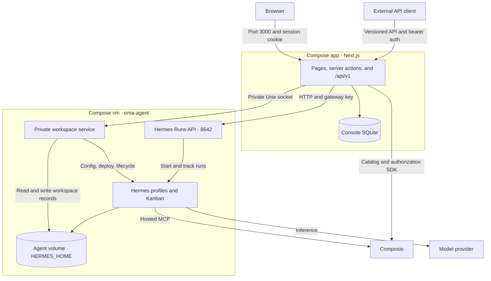
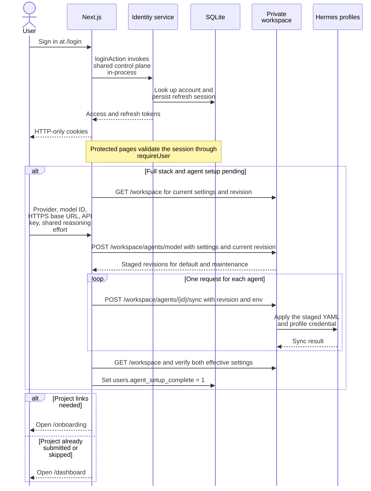
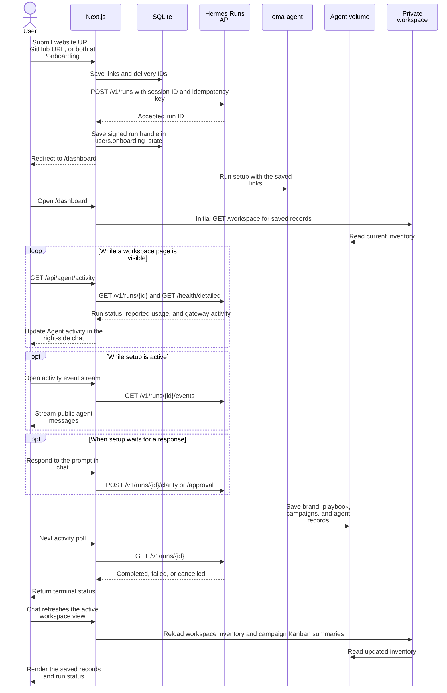
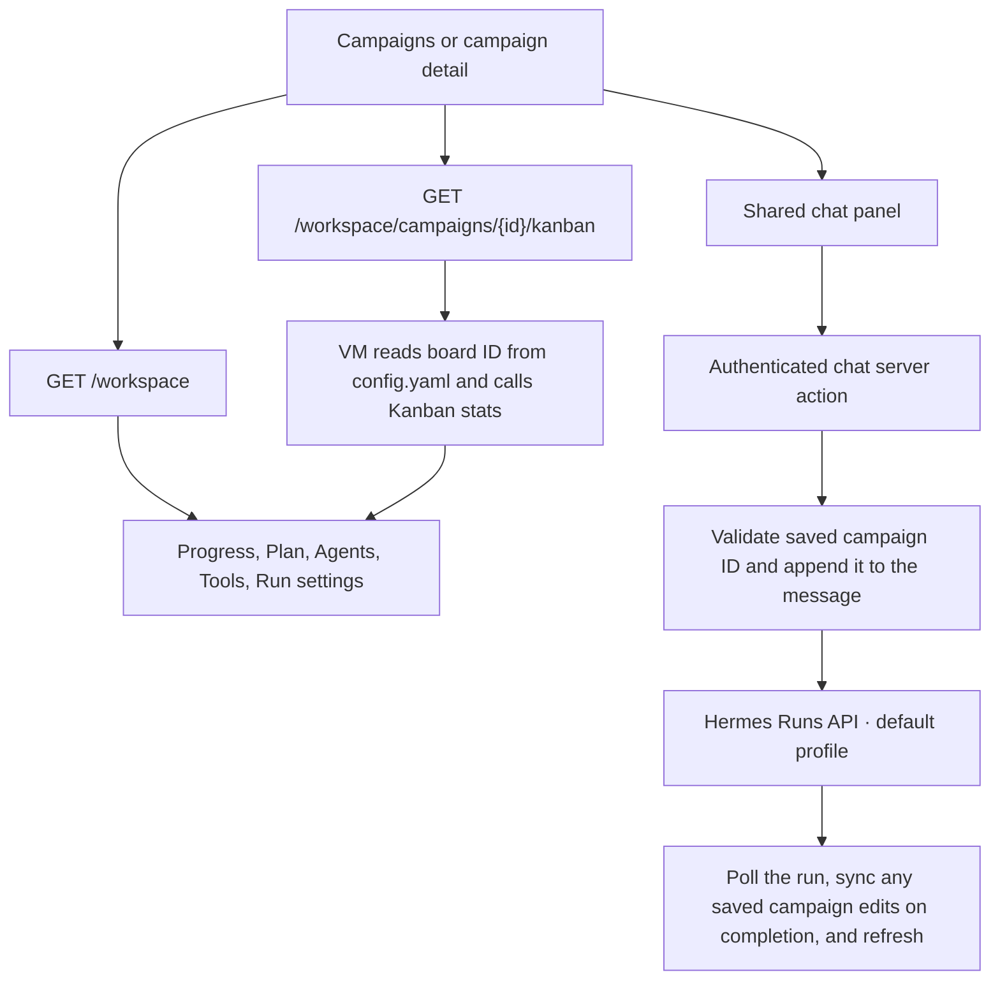
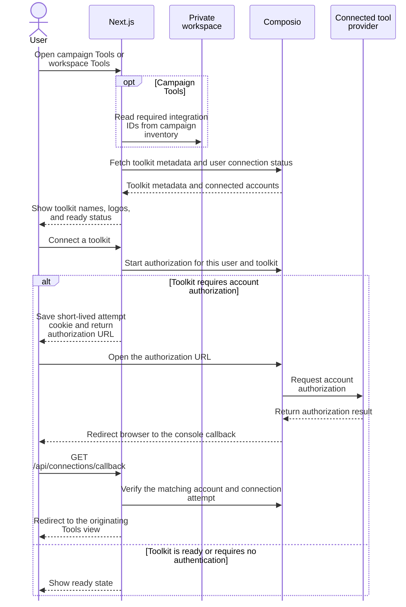
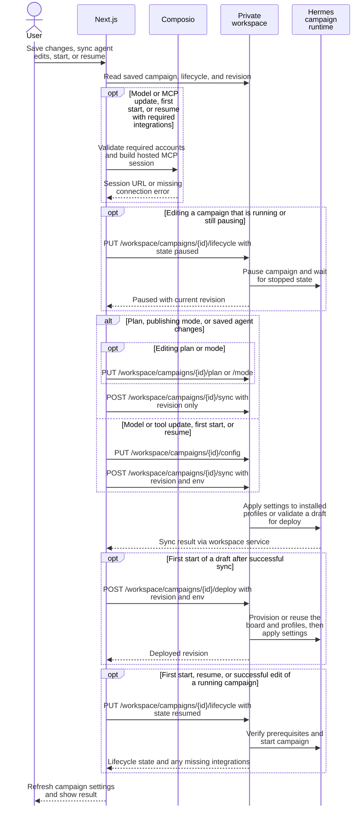
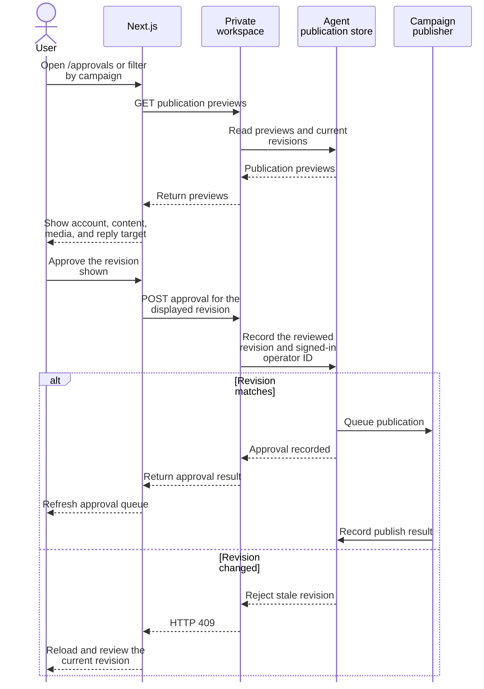

# Open Marketing Agency architecture

Use this guide to trace a browser action to the Next.js handler, the oma-agent API it calls, and the data it reads or writes. It describes the self-hosted Compose stack and links to the code for each workflow. Keep agent-owned data in oma-agent and read it through its APIs. The console database holds app-owned state such as account and session records.

- [System map](#1-system-map)
- [Sign-in and agent setup](#2-sign-in-and-agent-setup)
- [Project setup and dashboard refresh](#3-project-setup-and-dashboard-refresh)
- [Campaign views and chat](#4-campaign-views-and-chat)
- [Tool catalog and authorization](#5-tool-catalog-and-authorization)
- [Campaign save, sync, deploy, and start](#6-campaign-save-sync-deploy-and-start)
- [Publication approval](#7-publication-approval)
- [API and storage reference](#8-api-and-storage-reference)
- [Local development and debugging](#9-local-development-and-debugging)

## 1. System map

The port numbers are defaults for local Compose. The browser talks to the console. Next.js handles the workspace socket and Hermes gateway credentials server-side. The Hermes dashboard and its Kanban API run on port 9119. Optional catalog apps use Traefik on port 18080. Camofox is an optional browser sidecar on the private Compose network. [Compose base](../compose.yaml) · [Agent overlay](../compose.vm.yaml) · [VM startup](../vm/start.sh) · [Camofox overlay](../compose.camofox.yaml)

## 2. Sign-in and agent setup

Registration creates the installation’s single account and signs it in. The full-stack setup gates run when entering onboarding or a protected console route. With only the console, the login action opens the dashboard and the agent setup gate is disabled. Settings uses the same shared model save and sync path later.

The shared model save stages credential references in the agent YAML. The submitted key travels in the two private sync requests and is stored in Hermes profile credentials. The setup flag confirms both settings were applied and read back. A model call happens later when a run starts.

**Code to read** · [Auth actions](../oma/app/actions/auth.ts) · [In-process API client](../oma/lib/backend.ts) · [Session gate](../oma/lib/dal.ts) · [Agent setup flag](../oma/lib/server/agent-setup.ts) · [Settings action](../oma/app/actions/workspace.ts) · [Sync orchestration](../oma/lib/server/agent-workspace.ts)

## 3. Project setup and dashboard refresh

The app treats a saved run handle as successful submission and allows the user into Campaigns. It tracks execution separately with Hermes. Agent activity polls about every 2.5 seconds during active work and every 12 seconds when idle. The shared chat panel gets live messages from `GET /api/agent/activity?stream=1`. It refreshes the active workspace view after it sees an active run reach a terminal state. Opening or reloading the dashboard also reads the current workspace. The dashboard can show partial records if the run saved them before a failure.

**Retry setup** starts a new run with the saved links after a confirmed failure or cancellation. If a submission response is lost, retry reuses that attempt’s saved idempotency key. **Skip setup** records a skip and opens Campaigns without starting a run. The older interactive flow remains at **Onboarding backup**.

**Code to read** · [Project setup action](../oma/app/actions/project-setup.ts) · [Saved links and retry logic](../oma/lib/server/project-setup.ts) · [Activity route](../oma/app/api/agent/activity/route.ts) · [Activity polling and refresh](../oma/components/agent-activity.tsx) · [Onboarding backup](../oma/app/onboarding-backup/page.tsx)

## 4. Campaign views and chat

The campaign page reads the saved campaign, related agent records, required integrations, and current board summary. Board lookup prefers `kanban_board` and falls back to a unique `kanban_board_name` for older records. The Next.js server reads the summary counts over the private workspace socket. The default **Progress** section requests `GET /api/campaigns/{id}/progress` while visible. The same route accepts a validated `task` query for the expanded row. The workspace service resolves the saved board for both calls, reads Hermes `/board` or `/tasks/{id}`, and projects task status, history, and results. It also reads saved runtime schedule status from the campaign profiles. Next.js adds a short list of native publication statuses. The browser receives neither the dashboard token nor any raw worker logs.

The console layout renders the right-side chat panel through the `@conversation` parallel route, with entries for signed-in workspace paths. The panel shows the workspace conversation or the conversation for the campaign on the current detail page. It keeps the selected conversation while the operator switches campaign tabs. oma-agent stores each conversation in a Hermes session scoped by account and campaign. The console loads the native transcript and resumes that session when it is reopened. Both scopes use the default profile. The server appends the campaign ID to each message sent from a campaign. Chat polls `GET /v1/runs/{id}` and posts clarification answers or tool approval decisions to `POST /v1/runs/{id}/clarify` or `POST /v1/runs/{id}/approval`. These tool approvals belong to the current run. Follow-up messages during an active turn go to `POST /v1/runs/{id}/steer` through the same signed, account-scoped handle. Hermes supplies the display text for steering messages in the native transcript.

**Code to read** · [Campaign route](<../oma/app/(console)/(workspace)/campaigns/[id]/page.tsx>) · [Campaign tabs](../oma/components/campaign-detail.tsx) · [Conversation route](<../oma/app/(console)/@conversation/conversation.tsx>) · [Chat UI](../oma/components/hermes-chat.tsx) · [Chat actions](../oma/app/actions/chat.ts) · [Hermes gateway client](../oma/lib/server/agent-chat.ts)

The status strip above the chat composer uses the same run poll to show queueing, the current tool when reported, and waits for clarification or approval. The last-activity time comes from the gateway, not the poll time. This measures activity, not percentage complete, and is separate from the workspace-wide Agent activity panel.

## 5. Tool catalog and authorization

Campaign requirements come from the `integrations` list in `campaigns/{id}/config.yaml`. The workspace service maps canonical IDs to verified toolkit slugs. Campaign **Tools** displays the saved integration list and connects required accounts. The workspace-wide **Tools** page provides catalog search and shared account management. The campaign’s saved integration list determines which toolkits the campaign MCP session receives.

**Code to read** · [Toolkit browser](../oma/components/toolkit-browser.tsx) · [Composio actions](../oma/app/actions/composio.ts) · [OAuth callback](../oma/app/api/connections/callback/route.ts) · [Account and MCP sessions](../oma/lib/tool-connection-service.ts) · [Campaign toolkit resolution](../oma/lib/tool-workspace.ts)

## 6. Campaign save, sync, deploy, and start

- Model overrides are optional. Campaign profiles inherit the default model and its credential when there is no override. A model or MCP update sends only the relevant credential values in the private sync or deploy body. Plan, mode, and agent sync omit the credential body. Resume uses the existing deployment.
- **Approve** is the default mode and requires review before publication. **Yolo** runs automation and auto-approves new drafts. **Control** pauses scheduled work and runs explicitly approved publications.
- Each mutation uses the latest revision from the previous step. A stale revision gives `409` and requires a reload. A save can succeed before sync fails. If a running campaign was paused for the change, it remains paused until a successful sync and resume.

**Code to read** · [Campaign settings UI](../oma/components/campaign-settings.tsx) · [Mode settings UI](../oma/components/campaign-mode-settings.tsx) · [Workspace actions](../oma/app/actions/workspace.ts) · [Pause, sync, deploy, and resume](../oma/lib/server/agent-workspace.ts) · [Private endpoint implementations](../vm/workspace.py)

## 7. Publication approval

This flow requires an agent image that supports native publications. The private API lists previews with `GET /workspace/campaigns/{id}/publications` and approves with `POST /workspace/campaigns/{id}/publications/{publication-id}/approve`. The browser submits the displayed revision. The Next.js server derives the operator ID from the session. The agent owns the publication record, queue, and result, so a queued approval can be tracked separately from provider publication success.

**Code to read** · [Approvals route](<../oma/app/(console)/(workspace)/approvals/page.tsx>) · [Publication response validation](../oma/lib/server/agent-publications.ts) · [Approval action](../oma/app/actions/workspace.ts) · [Agent workspace routes](../vm/workspace.py)

## 8. API and storage reference

| Surface | Entry point | What it owns |
| --- | --- | --- |
| Console routes and server actions | App Router under [oma/app](../oma/app) | Cookie sessions, rendering, browser forms, and server-side orchestration. |
| Public versioned API | [Control-plane route](<../oma/app/api/v1/[...segments]/route.ts>) | Identity, current user profile, and generic MCP integration records. Sign-in uses `POST /api/v1/auth/jwt/login`. Protected endpoints use bearer tokens. Browse live [API docs](http://localhost:3000/docs) when the app is running. |
| Console activity API | [Activity route](../oma/app/api/agent/activity/route.ts) | Authenticated, uncached activity snapshots and public message streaming. |
| Private workspace API | [Workspace service](../vm/workspace.py) | Workspace reads, Kanban summaries, config updates, sync, deployment, lifecycle, and publication approvals. Next.js connects through `/run/oma-console/workspace.sock`. |
| Hermes gateway | [Agent chat client](../oma/lib/server/agent-chat.ts) | Run creation, status, events, clarification, and run-level tool approvals. The gateway key is distinct from the model API key. |
| Composio | [Composio SDK adapter](../oma/lib/composio.ts) | Hosted toolkit catalog, OAuth accounts, and campaign MCP sessions. |
| Optional local apps | [VM startup](../vm/start.sh) | `omactl` and Traefik manage separate catalog apps. Optional Camofox supplies browser tooling to the agent. |

| Data | Source of truth |
| --- | --- |
| Account, refresh sessions, setup flag, project answers and run handle | Console SQLite at `/app/data/oma.sqlite`. Local Compose binds `.oma-data/` to `/app/data`. |
| Workspace and campaign conversations | oma-agent’s native Hermes sessions, read through `GET /api/sessions` and `GET /api/sessions/{id}/messages`. |
| Generic MCP integration records created with the versioned API | Console SQLite `mcp_integrations`. Submitted credentials are encrypted at rest and write-only. This API is separate from hosted Composio accounts. |
| Brand, playbook, campaigns, and authored agent records | Agent volume under `$HERMES_HOME/oma/`. Key paths are `brand/config.yaml`, `playbook/config.yaml`, `campaigns/{id}/config.yaml`, and `agents/{id}/config.yaml`. |
| Effective model and tool settings, model credentials, schedules, Kanban, and agent run state | Native Hermes state in the agent volume at `$HERMES_HOME`, which defaults to `/opt/data`. Agent YAML stores credential references. Hermes profile credential files store key values. |
| Composio account authorization and hosted sessions | Composio. The campaign YAML holds the generated MCP URL and a reference to the Composio key. |
| Local gateway access | A shared Compose mount at `/run/oma-console` provides the gateway key and workspace socket to the console. |

## 9. Local development and debugging

Start the full stack with `make dev` and open [the console](http://localhost:3000). Use the [application development guide](../oma/README.md) for direct Next.js development and the [root README](../README.md) for environment, deployment, and VM smoke-test commands.

| Symptom or task | Start here |
| --- | --- |
| Login loops or missing session | [Auth actions](../oma/app/actions/auth.ts), [session validation](../oma/lib/dal.ts), and [identity sessions](../oma/lib/server/identity/sessions.ts). |
| Agent setup asks for a reload | [Agent settings tests](../oma/tests/agent-setup.test.ts) and the [workspace service’s revision checks](../vm/workspace.py). Reload to obtain the latest saved revision. |
| Dashboard shows setup failed or misses new campaigns | [Project setup tests](../oma/tests/project-setup.test.ts), [run status projection](../oma/lib/server/agent-chat.ts), and the [dashboard loader](<../oma/app/(console)/(workspace)/dashboard/page.tsx>). Check the run status and what oma-agent saved. |
| Toolkit connects but campaign can’t start | [Connection service](../oma/lib/tool-connection-service.ts), [integration tests](../oma/tests/campaign-integrations.test.ts), and the campaign’s saved integration IDs. |
| Settings saved but sync failed | [Campaign settings tests](../oma/tests/campaign-settings.test.ts) and [VM deployment tests](../vm/tests/campaign_deploy.py). Check the native profiles, board routing, and campaign schedules. |
| Publication preview or approval fails | [Publication tests](../oma/tests/agent-publications.test.ts), the agent image’s native publication support, and the current publication revision. |
